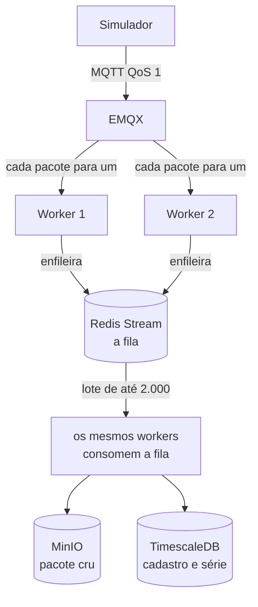
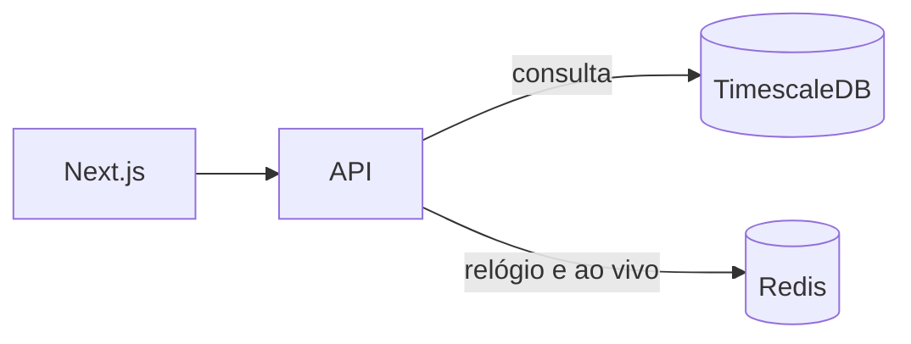

# Celsius 360

Versão reduzida da plataforma de conforto térmico da Diel Energia. Recebe a telemetria dos dispositivos, guarda o cru, calcula o estado da rede e mostra isso na web.

## Como rodar

Requisitos: Docker e Docker Compose.

```sh
docker compose up -d --build
```

A primeira subida aplica as migrations e o cadastro de exemplo. A senha de todos os usuários de exemplo é `change-me`. Ela não fica gravada no banco: o seed guarda só o hash.

O simulador publica os 180.951 pacotes, um a um. A web abre antes do fim. Acompanhe com:

```sh
docker compose logs -f simulator
```

A linha `published 180951` encerra a carga. Até a primeira telemetria, o cabeçalho diz "Aguardando a primeira telemetria". Depois mostra o "agora", que é o instante da amostra mais nova.

| Serviço | Endereço |
| --- | --- |
| Web | http://localhost:3001 |
| API | http://localhost:3000/api/v1 |
| OpenAPI | http://localhost:3000/openapi.json |
| Grafana | http://localhost:3003 |

Usuários de exemplo:

| E-mail | Perfil |
| --- | --- |
| ana.ribeiro@diel.example | Operador Diel. Escolhe o cliente antes de ver a rede. |
| carlos.mendes@modacarioca.example | Gestor da Moda Carioca. |
| juliana.prado@modacarioca.example | Gerente da Loja Paulista. |
| roberto.lima@bancohorizonte.example | Gestor do Banco Horizonte. |

Para reprocessar o arquivo na ordem de chegada, com o stack no ar:

```sh
docker compose run --rm -e TELEMETRY_FILE=/repo/data/telemetrias.jsonl ingestion-worker node dist/replay-file.js
```

O diretório `data/` entra no worker pelo volume. O comando imprime `replayed` a cada lote de 2.000 linhas. O simulador, na subida, imprime `published` a cada mil pacotes.

Testes:

```sh
docker compose --profile test run --rm unit-tests
docker compose --profile test run --rm e2e-tests
```

## Arquitetura



O pacote só chega no MinIO e no TimescaleDB depois de passar pela stream. A seta "consulta" lê essa série. A seta "relógio e ao vivo" é o mesmo Redis da fila, em outro papel.



O relógio é a chave `system:virtual_now`, o instante da amostra mais nova já gravada. O arquivo termina em fevereiro de 2026, então status e períodos usam esse instante, e não o horário da máquina. O worker só avança a chave. Pacote atrasado fica no passado dele. O "Agora" do cabeçalho é esse valor, em horário de Brasília. Online é visto nos últimos 15 minutos dele.

O ao vivo é um aviso no canal `live:{cliente}`, no máximo um por segundo por ambiente, com temperatura, conforto e status. A API entrega isso no WebSocket `/live` para quem está com a tela daquele cliente aberta. O aviso some se ninguém estiver ouvindo. O que fica guardado é a linha no TimescaleDB.

Dois workers da mesma imagem assinam `$share/ingestion/diel/telemetry`. Cada pacote entra uma vez e o worker enfileira a linha na stream. Os dois consomem essa stream, cada um com nome próprio. O mesmo dispositivo segue numa faixa só dentro do processo. Entre processos, a amostra é única por ambiente e instante, e o relógio virtual só anda para frente.

## Decisões

O cadastro muda pouco e fica no Postgres. A série cresce com o tempo e fica numa hypertable do TimescaleDB, com agregação horária contínua. O cru é imutável: cada lote vira um objeto novo no MinIO, em `dt=AAAA-MM-DD/hour=HH/client=ID/{id}.jsonl.gz`. Fila, relógio e aviso ao vivo ficam no Redis.

Online, offline e sem dados usam o "agora" da amostra mais nova. Visto nos últimos 15 minutos, visto antes disso, ou nunca visto.

O arquivo `telemetrias.jsonl` tem 180.951 pacotes. Três casos saem do caminho normal:

- 247 chegaram atrasados (`saved_data`). A amostra entra no instante calculado. O relógio segue no pacote mais novo.
- 220 trazem ao menos uma leitura fora de −10 °C a 60 °C. A leitura vira anomalia e fica fora da série.
- Cerca de 1.100 linhas repetem o mesmo dispositivo no mesmo timestamp. A chave única de ambiente e instante guarda uma amostra e uma anomalia, também quando o arquivo roda de novo.

O conforto do período é a fração do expediente em que a temperatura ficou na faixa, no fuso da loja. Cada amostra na faixa cobre 30 segundos, o intervalo do arquivo. Expediente sem leitura pesa no denominador, e o gráfico mostra essa lacuna.

A visão da rede pagina, filtra por cliente, loja, ambiente, faixa e status do dispositivo, e ordena. A lista traz o resumo. A série abre no detalhe, e janelas de 1 hora ou mais leem a agregação horária.

A observabilidade sobe com a stack. O Prometheus lê `/metrics`. O Promtail manda o log dos containers ao Loki. O Grafana abre com as três fontes e o painel Ingestão, em http://localhost:3003. A senha inicial é a de `GRAFANA_ADMIN_PASSWORD`, `change-me` no exemplo.
