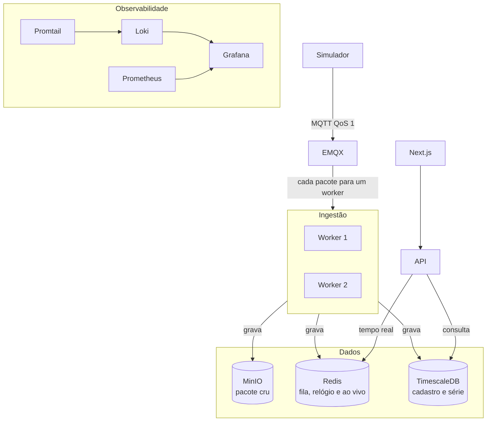

# Celsius 360

Versão reduzida da plataforma de conforto térmico da Diel Energia. Recebe a telemetria dos dispositivos, guarda o cru, calcula o estado da rede e mostra isso na web.

## Como rodar

Requisitos: Docker e Docker Compose.

```sh
docker compose up -d --build
```

A primeira subida aplica as migrations e o cadastro de exemplo. A senha de todos os usuários de exemplo é `change-me`. Ela não fica gravada no banco: o seed guarda só o hash.

O simulador publica os 180.951 pacotes, um a um. A web abre antes do fim. Acompanhe com:

```sh
docker compose logs -f simulator
```

A linha `published 180951` encerra a carga. Até a primeira telemetria, o cabeçalho diz "Aguardando a primeira telemetria". Depois mostra o "agora", que é o instante da amostra mais nova.

| Serviço | Endereço |
| --- | --- |
| Web | http://localhost:3001 |
| API | http://localhost:3000/api/v1 |
| OpenAPI | http://localhost:3000/openapi.json |
| Grafana | http://localhost:3003 |

Usuários de exemplo:

| E-mail | Perfil |
| --- | --- |
| ana.ribeiro@diel.example | Operador Diel. Escolhe o cliente antes de ver a rede. |
| carlos.mendes@modacarioca.example | Gestor da Moda Carioca. |
| juliana.prado@modacarioca.example | Gerente da Loja Paulista. |
| roberto.lima@bancohorizonte.example | Gestor do Banco Horizonte. |

Para reprocessar o arquivo na ordem de chegada, com o stack no ar:

```sh
docker compose run --rm -e TELEMETRY_FILE=/repo/data/telemetrias.jsonl ingestion-worker node dist/replay-file.js
```

O diretório `data/` entra no worker pelo volume. O comando imprime `replayed` a cada lote de 2.000 linhas. O simulador, na subida, imprime `published` a cada mil pacotes.

Testes:

```sh
docker compose --profile test run --rm unit-tests
docker compose --profile test run --rm e2e-tests
```

## Arquitetura



Dois workers da mesma imagem assinam `$share/ingestion/diel/telemetry`. Cada pacote entra uma vez. Os dois leem a mesma stream do Redis, cada um com nome próprio. O mesmo dispositivo segue numa faixa só dentro do processo. Entre processos, a amostra é única por ambiente e instante, e o relógio virtual só anda para frente.

## Decisões

O cadastro fica no Postgres. A série tratada fica numa hypertable do TimescaleDB, com agregação horária contínua. O pacote cru vai para o MinIO, um objeto novo por lote, em `dt=AAAA-MM-DD/hour=HH/client=ID/{id}.jsonl.gz`. A fila, o relógio virtual e o tempo real ficam no Redis. São naturezas diferentes: cadastro muda pouco, a série cresce por tempo, e o cru é arquivo imutável.

O "agora" é o instante da amostra mais nova já processada, e o cabeçalho da web mostra esse horário. Online significa visto nos últimos 15 minutos desse relógio. Offline é visto antes disso. Sem dados é nunca visto.

O arquivo `telemetrias.jsonl` tem 180.951 pacotes. Desses, 247 vieram atrasados (`saved_data`), 220 trazem ao menos uma leitura fora de −10 °C a 60 °C, e cerca de 1.100 linhas repetem o mesmo dispositivo no mesmo timestamp. Leitura fora da faixa vira anomalia e não entra na série. Pacote atrasado grava no instante calculado e não puxa o relógio para trás. Repetição esbarra na chave única de ambiente e instante, então rodar de novo não duplica amostra nem anomalia.

O conforto do período é tempo, não contagem de amostra. O denominador é o expediente do ambiente dentro da janela, no fuso da loja. Cada amostra dentro da faixa cobre 30 segundos, o intervalo do arquivo. O expediente em que o dispositivo ficou mudo entra no denominador e não no numerador. A lacuna também aparece no gráfico.

A visão da rede pagina, filtra por cliente, loja, ambiente, faixa e status do dispositivo, e ordena. A lista não carrega a série. O detalhe lê a agregação horária nas janelas de 1 hora ou mais.

A observabilidade sobe com a stack. O Prometheus lê `/metrics`. O Promtail manda o log dos containers ao Loki. O Grafana abre com as três fontes e o painel Ingestão, em http://localhost:3003. A senha inicial é a de `GRAFANA_ADMIN_PASSWORD`, `change-me` no exemplo.
